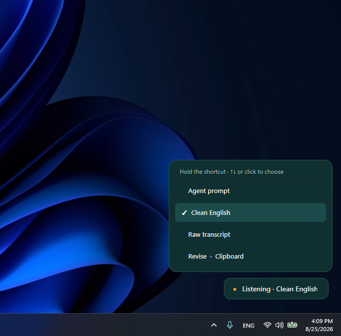
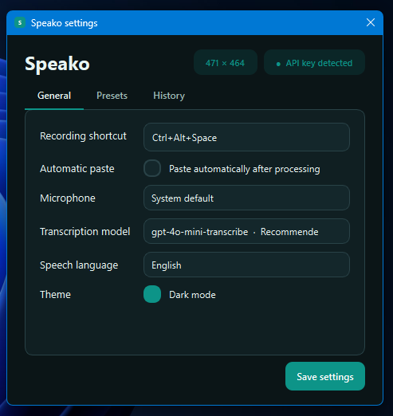
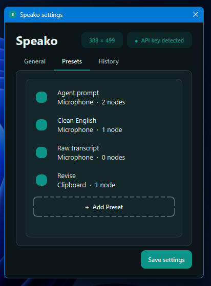
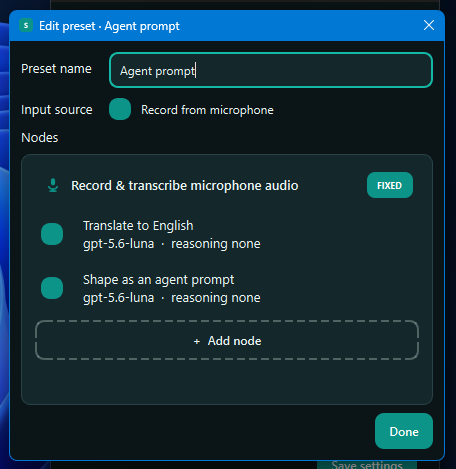

# Speako

Speako is a lightweight Windows tray app that turns speech into polished text or AI-ready prompts. It records from your microphone, transcribes with OpenAI, runs the text through an editable processing pipeline, and copies or pastes the result into your active application.

## Screenshots

<table>
  <tr>
    <th>Recording and preset chooser</th>
    <th>General settings</th>
  </tr>
  <tr>
    <td><a href="docs/screenshots/recording.png"></a></td>
    <td><a href="docs/screenshots/general-settings.png"></a></td>
  </tr>
  <tr>
    <th>Preset list</th>
    <th>Pipeline editor</th>
  </tr>
  <tr>
    <td><a href="docs/screenshots/presets.png"></a></td>
    <td><a href="docs/screenshots/pipeline-editor.png"></a></td>
  </tr>
</table>

## Features

- Global start/stop shortcut with a hold-to-select preset menu
- Hebrew, English, or automatic language detection
- Editable presets composed of independent GPT processing nodes
- Per-node model and reasoning controls
- Automatic clipboard copy and optional `Ctrl+V`
- Microphone selection, light/dark themes, and recent workflow details
- Cancellation by pressing the shortcut during processing

## Requirements

- Windows 10 or 11
- Python 3.11+
- An OpenAI API key with API billing enabled

## Setup

```powershell
powershell -NoProfile -ExecutionPolicy Bypass -File .\setup.ps1
```

Setup creates an isolated `.venv`, installs Speako and its dependencies there,
and creates or updates the **Speako** Desktop shortcut. It preserves an existing
`.env`. No environment activation or global Python packages are needed.
Python itself must remain installed. Rerun setup after moving the project;
recreate `.venv` if you move it or replace its base Python installation.

To select a particular Python installation, append `-Python "C:\Python313\python.exe"`.
For development and tests, append `-Dev`.

Add your key to `.env`:

```env
OPENAI_API_KEY=your-api-key
```

Then double-click **Speako** on your Desktop. To start it with a console for
troubleshooting, run from the project directory:

```powershell
.\.venv\Scripts\python.exe -I -m speako
```

Run tests after setup with `-Dev`:

```powershell
.\.venv\Scripts\python.exe -I -m pytest
```

Keep `.venv` out of Git and archive backups; recreate it with setup when needed.
The shortcut uses this environment exclusively, ignoring user-installed packages
and Python environment-variable overrides.

## Usage

1. Press `Ctrl+Alt+Space` to start recording.
2. Press it again to stop and process the recording.
3. Press it during processing to cancel.

To choose another preset, keep the initial shortcut held, move with `↑` / `↓` or click a preset, then release the shortcut. If you make no selection, Speako uses the first preset. Completed output is copied and pasted automatically unless automatic paste is disabled in Settings.

Speako stores settings and recent workflow details under `%APPDATA%\Speako`. Audio is processed in memory and is not saved to disk by Speako. Keep `.env` private and never commit it.
